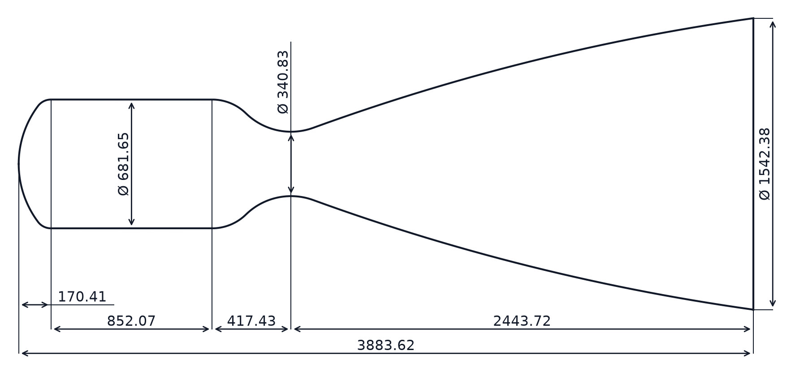
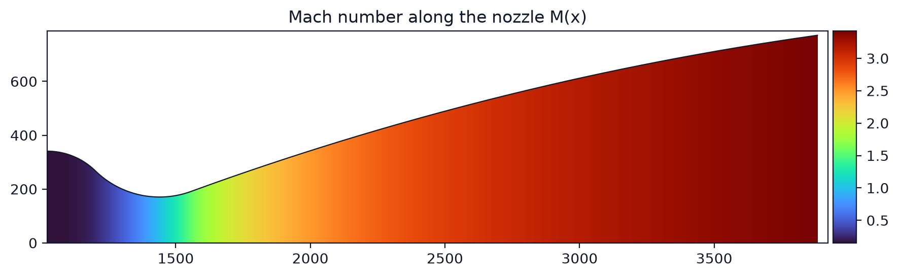
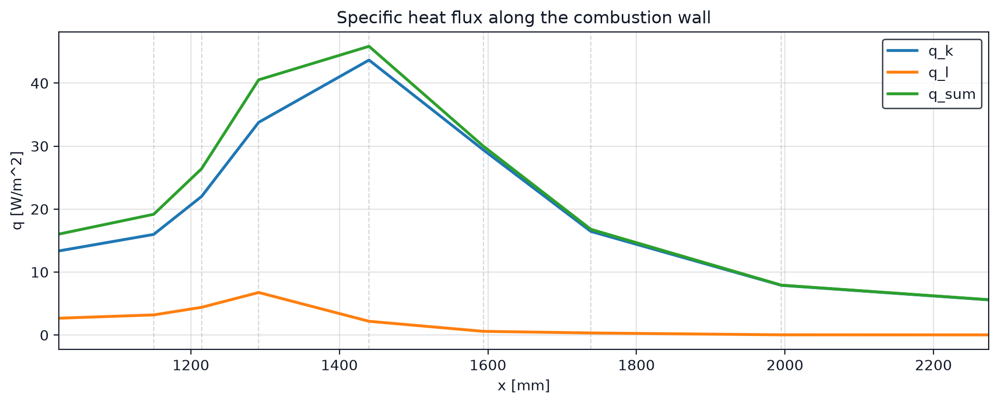

# LRE Nozzle Designer

**LRE Nozzle Designer** is a desktop application for calculating liquid rocket engine parameters and nozzle geometry, plotting calculated distributions, and estimating thermal loads. The user interface is available in English and Russian.

## Copyright holder and contact

**Joint-Stock Company “National Center of Space Research and Technology”**<br>
15 Shevchenko St., Almaty, 050010, Kazakhstan<br>
Email: nckit@spaceres.kz<br>
Website: https://spaceres.kz/

**Developer contact:**<br>
Yevgeniya Tleukhabylova — tleukhabylova@gmail.com

Copyright © 2026 Joint-Stock Company “National Center of Space Research and Technology”.

## Features

- propellant-pair selection;
- engine and nozzle-geometry calculations;
- nozzle geometry, pressure, temperature, and Mach-number plots;
- combustion-chamber and nozzle-wall thermal-load calculations;
- export of results to text, CSV, and Excel files;
- light and dark interface themes.

## Screenshots

### Nozzle geometry



### Mach number distribution



### Specific heat flux



## Requirements

- Windows 10 or 11;
- Python 3.12;
- the packages listed in `requirements.txt`.

## Open-source components and data provenance

LRE Nozzle Designer was developed using open-source components from the
Python scientific ecosystem. These components remain subject to their own
licenses and are not relicensed by this project:

- [Python](https://www.python.org/) - PSF License;
- [NumPy](https://numpy.org/) - BSD 3-Clause License;
- [pandas](https://pandas.pydata.org/) - BSD 3-Clause License;
- [SciPy](https://scipy.org/) - BSD 3-Clause License;
- [Matplotlib](https://matplotlib.org/) - PSF-based Matplotlib License;
- [openpyxl](https://openpyxl.readthedocs.io/) - MIT License;
- [PyQt5](https://www.riverbankcomputing.com/software/pyqt/) - GNU GPL v3
  or Riverbank Commercial License.

The engineering equations, constants, and reference values used by the
application were compiled from publicly available technical and educational
sources and then implemented and checked by the authors. The bundled thermal
reference files (`q0_digitized_reference_table.csv` and the `pair */` data
directories) contain author-prepared digitizations of the reference curves in
Figures 5-10 of the following educational publication:

> L. I. Grechukh and I. N. Grechukh, *Design of a Liquid Rocket Engine*
> (`Проектирование жидкостного ракетного двигателя`), methodological guidance
> for course and diploma design, Omsk State Technical University, Omsk, 2011,
> pp. 24-34.

The publication is listed by
[Omsk State Technical University](https://omgtu.ru/general_information/faculties/faculty_of_transport_oil_and_gas/the_department_quot_aviation_and_rocket_quot/teaching_staff/l_grech.php).
The reference datasets are used for research, educational, and verification
purposes and are not presented as original experimental measurements. Public
availability of a source does not by itself mean that the source is in the
public domain or distributed under an open-data license. Redistribution of
the application, its bundled data, and binary builds must comply with the
applicable licenses and source-material terms. Exact third-party notices
should be generated for the dependency versions included in each binary
release.

## Installation

1. Download or clone the repository.
2. Open PowerShell in the project directory.
3. Create a virtual environment:

   ```powershell
   py -3.12 -m venv .venv
   ```

4. Activate it:

   ```powershell
   .\.venv\Scripts\Activate.ps1
   ```

5. Install the dependencies:

   ```powershell
   python -m pip install --upgrade pip
   python -m pip install -r requirements.txt
   ```

## Running the application

```powershell
python main.py
```

## Project structure

- `main.py` contains the main PyQt application window and coordinates the calculation workflow.
- `lre_tool/` contains calculation models, plotting, persistence, validation, styling, dialogs, and UI-page modules.
- `pair */` directories contain reference data used by the thermal-load calculation.
- `ARCHITECTURE.md` describes the module boundaries and refactoring rules.

Thermal reference CSV files are named after the corresponding gas-wall temperature in kelvins, for example `600.csv`.

## Engineering notice

This application performs engineering calculations. Before practical use, verify its results independently and against relevant technical documentation.

## Author

[tleukhabylova-del](https://github.com/tleukhabylova-del)
